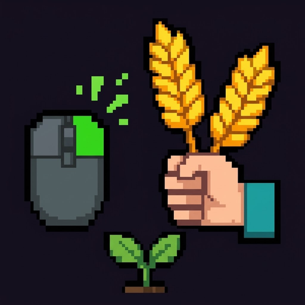

  

<h1 align="center">Right-Click Crops</h1>

  <strong>Harvest with a right-click. Keep your garden growing.</strong> 
  A WebAssembly Horizon mod with sixteen plant families and individual settings.

  
  
  

  <a href="https://playhorizon.dev/mods/right_click_crops">Horizon page</a> &middot;
  <a href="https://github.com/AyanoKaito/horizon-right-click-crops/releases/tag/v2.0.1"><strong>Download</strong></a> &middot;
  <a href="docs/installation.md">Installation</a> &middot;
  <a href="docs/settings.md">Settings</a> &middot;
  <a href="https://youtu.be/kll-qvj5s54">Watch demo</a>

  Last updated and checked: <strong>November 19, 2026</strong>. 
  See the compatibility notes below for the scope of testing.

---

## Supported plants

| Behaviour | Plants |
|---|---|
| Harvest and replant | Wheat, carrots, potatoes, beetroot, nether wart, cocoa, torchflower, pitcher crop |
| Harvest upper growth and retain the base | Sugar cane, cactus, bamboo, kelp, twisting vines, weeping vines |
| Harvest fruit and retain the stem | Pumpkin, melon |
| Ordinary Horizon behaviour | Sweet berries, glow berries |

Plants outside this list pass through unchanged. Compatibility with arbitrary crops from other mods is not claimed.

See the **[Harvesting guide](docs/harvesting.md)** for planting materials, retained bases and stems, vine drop chances, and reasons a click may not harvest or replant.

## Features

- Harvest one targeted mature plant with right-click.
- Use Horizon's ordinary loot calculation, including applicable tool and Fortune effects.
- Replant with exactly one matching item from generated loot, then fall back to the player's inventory.
- Harvest without replanting when no matching item exists; never create a free seed.
- Retain the base of vertical plants and the attached stem of pumpkins and melons.
- Toggle all sixteen managed plant families separately under `Options > Mods > Right-Click Crops > Config`.
- Leave immature plants, bone meal, ordinary left-click breaking, sweet berries, glow berries and unrelated interactions to Horizon.

The mod handles one targeted plant at a time. It does not add area harvesting, bonus loot, hunger costs or experience costs.

## Demo

[Watch on YouTube](https://youtu.be/kll-qvj5s54) — harvesting, replanting and individual plant settings.

## Installation

Install Right-Click Crops from the Horizon launcher's **Mods** page and turn it on there. Version 2 is a WebAssembly mod: it runs in Horizon's mod sandbox, with no native build and no native-code trust prompt. You can also install the `.hmod` from the GitHub Release by hand.

See [Installation](docs/installation.md), [Settings](docs/settings.md) and [Compatibility](docs/multiplayer.md) for the current details.

## Compatibility

- Compatibility last reviewed on **November 19, 2026**, for Minecraft 26.3.
- Built with Horizon mod SDK `f00125f` (mod API 0.2) as `mod.wasm`.
- Harvesting runs on the authoritative server path used by single-player, LAN hosts and LAN guests.
- Single-player and LAN host/guest checks passed on Horizon Nightly `2026-11-19` (`f00125f`). See [Validation](VALIDATION.md) for the exact results.
- Dedicated servers are not advertised until a dedicated gameplay check passes.

## Project integrity

The official repository is <https://github.com/AyanoKaito/horizon-right-click-crops>. Third-party forks cannot change this repository or its releases. Verify release downloads with their Minisign signature; see [Installation](docs/installation.md).

Right-Click Crops is an original Horizon implementation, not a port. No gameplay code from other harvest mods was used. Similar projects were reviewed only to understand common player expectations and define scope.

Development was AI-assisted under human direction. AI tooling contributed to implementation, test harnesses and documentation; only checks that were actually run are reported as evidence.

The project icon was generated with Google Gemini (Nano Banana) under AyanoKaito's direction. Its provenance and licensing scope are recorded in [Third-party notices](THIRD_PARTY_NOTICES.md).

## License

Original project code and documentation are available under the [MIT License](LICENSE). Third-party materials retain their own notices in [THIRD_PARTY_NOTICES.md](THIRD_PARTY_NOTICES.md).

Right-Click Crops is not an official Horizon or Minecraft project and is not affiliated with or endorsed by Mojang or Microsoft.
